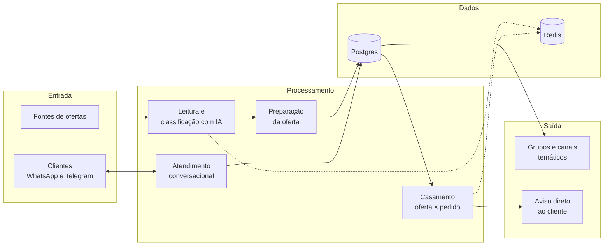

<h1 align="center">Eu Quero Whats · Arquitetura</h1>

  Um assistente de compras no WhatsApp e no Telegram: você diz o que quer comprar, e ele avisa quando aparece a promoção certa. 
  <a href="https://www.euquerowhats.com.br"><b>euquerowhats.com.br</b></a>

> Este repositório apresenta a visão geral do produto e da arquitetura. O código-fonte é privado.

---

## O problema

Promoções boas aparecem e somem em minutos, espalhadas por dezenas de canais e lojas. Quem quer comprar algo específico precisa acompanhar tudo isso o dia inteiro, ou acaba pagando mais caro.

## A solução

O cliente conversa com um robô no **WhatsApp** ou no **Telegram**, em linguagem natural:

> *"Quero uma airfryer até R$ 300"*

A partir daí, o sistema acompanha as ofertas que surgem nas maiores lojas do Brasil e avisa quando aparece uma que realmente atende o pedido, já com o link pronto para comprar. Além do atendimento individual, as ofertas também são distribuídas em **grupos e canais temáticos** (casa, tecnologia, moda, mercado, fitness…).

## Como funciona, em alto nível

- **Serviços independentes:** cada etapa roda como um serviço separado na nuvem. Uma falha num ponto não derruba o resto.
- **IA onde agrega:** a IA entende o pedido do cliente em português do dia a dia e estrutura as ofertas. Ela fica atrás de camadas de validação, porque mandar a oferta errada para alguém é pior que não mandar nada.
- **Orientado a eventos:** os serviços se comunicam por filas e gatilhos, sem consultas repetidas o tempo todo.
- **Observabilidade:** o próprio sistema mede volume, falhas e atrasos, compara com o comportamento normal e avisa quando algo precisa de atenção humana.
- **Custo enxuto:** a arquitetura foi desenhada para rodar em camadas gratuitas e créditos de nuvem, escalando só onde o uso pede.

## Tecnologias

  
  
  
  
  
  
  
  
  
  
  
  

## Conheça

- Site: [euquerowhats.com.br](https://www.euquerowhats.com.br)
- Grupos, canais e robô: [euquerowhats.com.br/links](https://www.euquerowhats.com.br/links)

---

<b>In English</b>

 

**Eu Quero Whats** is a shopping assistant on WhatsApp and Telegram. Customers say what they want to buy in plain Portuguese, and the system watches offers from Brazil's largest stores and notifies them when a deal actually matches their request, with a ready-to-buy link. Offers are also distributed to themed groups and channels.

The architecture is built from independent cloud services (ingestion, AI-based reading and classification, offer preparation, request matching, and conversational support), communicating through queues and triggers, backed by Postgres and Redis, with built-in observability that compares live behavior against the normal baseline and alerts only when human attention is needed. It is designed to run on free tiers and cloud credits.

The source code is private; this repository is an overview.

Criado por <a href="https://github.com/matheus306">Matheus Melo</a>

